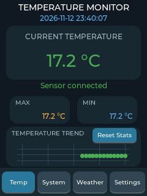
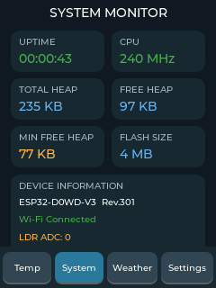
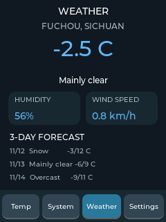
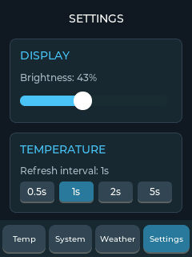

# ESP32 LVGL 学习仪表盘

一个跑在 ESP32 + 2.4 寸 SPI 屏上的入门级 LVGL 9 项目。四页式界面：DS18B20 实时温度、系统信息、Open-Meteo 天气预报、设备设置。所有页面通过底部导航栏切换，触摸操作，设置项掉电保存。


---

## 界面预览

| 温度 | 系统信息 | 天气 | 设置 |
| :---: | :---: | :---: | :---: |
|  |  |  |  |

> 截图由固件内置的 `screenshot` 串口命令导出到 SD 卡（BMP），再转成 PNG 存放在 `docs/images/`。

---

## 功能

| 页面 | 内容 |
| --- | --- |
| **Temp** | DS18B20 实时温度、NTP 时钟、传感器在线状态、本次运行的最高/最低温、30 点温度趋势曲线、一键重置统计 |
| **System** | 运行时长、CPU 频率、总堆 / 空闲堆 / 历史最小空闲堆、Flash 容量、芯片型号与版本、Wi-Fi 连接状态、LDR 环境光 ADC（GPIO34） |
| **Weather** | 当前温度、天气描述、湿度、风速，以及未来 3 天的日期 / 天气 / 最低最高温 |
| **Settings** | 屏幕亮度滑条（0–100%）、温度采样间隔（0.5s / 1s / 2s / 5s），均写入 NVS 掉电保存 |

界面统一使用深色配色（背景 `#101820`，卡片 `#1C2A35`，强调色蓝 `#64B5F6` / 绿 `#4CAF50` / 橙 `#FFB74D`），底部 46px 导航栏高亮当前页。

---

## 硬件

| 器件 | 型号 / 说明 |
| --- | --- |
| 开发板 | ESP32 DevKit（小黄板，ESP32-WROOM-32） |
| 屏幕 | ST7789 SPI TFT，240×320，2.4 寸 |
| 触摸 | XPT2046 电阻触摸（使用单独一组 SPI 引脚） |
| 温度传感器 | DS18B20 防水探头 |
| SD 卡模块 | SPI 接口（HSPI），FAT32，用于保存截图 |
| 光敏电阻 | LDR 模块，AO 接 ADC（GPIO34） |
| 其他 | 杜邦线、4.7kΩ 上拉电阻（DS18B20 DQ 必须上拉到 3.3V） |

### 接线

屏幕 + 触摸（`platformio.ini` 的 `build_flags` 与 `main.cpp` 中定义）：

| 信号 | GPIO | 说明 |
| --- | --- | --- |
| TFT_MOSI | 13 | 屏幕 SDA |
| TFT_MISO | 12 | 屏幕 SDO |
| TFT_SCLK | 14 | 屏幕 SCL |
| TFT_CS | 15 | 屏幕片选 |
| TFT_DC | 2 | 数据/命令 |
| TFT_RST | -1 | 未接，接开发板 EN |
| TFT_BL | 21 | 背光，PWM 调光 |
| TOUCH_SCLK | 25 | XPT2046 |
| TOUCH_MISO | 39 | XPT2046 |
| TOUCH_MOSI | 32 | XPT2046 |
| TOUCH_CS | 33 | XPT2046 |
| TOUCH_IRQ | 36 | XPT2046（仅输入引脚） |

DS18B20：

| 信号 | GPIO |
| --- | --- |
| DQ（数据） | 22（需 4.7kΩ 上拉到 3.3V） |
| VDD | 3.3V |
| GND | GND |

SD 卡（`src/storage.cpp`，使用独立的 HSPI 总线）：

| 信号 | GPIO | 说明 |
| --- | --- | --- |
| SD_CS | 5 | 片选 |
| SD_SCK | 18 | HSPI SCK |
| SD_MISO | 19 | HSPI MISO |
| SD_MOSI | 23 | HSPI MOSI |
| VCC | 3.3V | 裸卡座接 3.3V；带稳压的模块按模块标注 |
| GND | GND | |

光敏电阻（LDR 模块）：

| 信号 | GPIO | 说明 |
| --- | --- | --- |
| AO（模拟输出） | 34 | 仅输入引脚，无内部上拉 |
| VCC | 3.3V | |
| GND | GND | |

> SD 卡请格式化为 **FAT32**，建议 ≤ 32GB。上电不会自动挂载，需要先在串口执行 `sd` 命令（见下文「串口命令」）。

> ⚠️ GPIO2、GPIO5、GPIO12、GPIO15 都是 ESP32 的启动 strapping 引脚。GPIO5（SD_CS）在上电瞬间必须为高，否则会进入下载模式导致不启动；GPIO12（TFT_MISO）必须为低。如果上电后无法启动或反复复位，先拔掉 SD 卡模块和屏幕的数据线再试，或检查这些引脚有没有被外部电阻拉错电平。

---

## 软件栈

- **PlatformIO** + Arduino framework（`espressif32`，`board = esp32dev`）
- **LVGL 9.6.0**：`include/lv_conf.h`，`LV_MEM_SIZE = 64KB`，默认字体 Montserrat 14
- **TFT_eSPI 2.5.43**：驱动 ST7789，配置全部通过 `build_flags` 的 `USER_SETUP_LOADED` 传入，无需改 `User_Setup.h`
- **XPT2046_Touchscreen 1.4**
- **OneWire + DallasTemperature**：读 DS18B20
- **ArduinoJson 7**：解析天气 JSON
- **SD**（Arduino 内置库）：HSPI 上的 SD 卡，保存 BMP 截图
- **NTP**（`configTime`）：Wi-Fi 连上后自动对时，时区固定 UTC+8
- **Preferences**：NVS 持久化设置
- 分区表使用 `huge_app.csv`（大固件，无 OTA）

---

## 目录结构

```text
lvgl-learn/
├── platformio.ini          # 板型、依赖、TFT_eSPI 引脚与驱动配置
├── docs/
│   └── images/             # README 用的界面截图（由 screenshot 命令导出后转 PNG）
├── include/
│   ├── lv_conf.h           # LVGL 配置（字体、内存、控件开关）
│   ├── pages.h             # 页面创建 / 温度页更新接口
│   ├── settings.h          # DeviceSettings 与 NVS 读写接口
│   ├── weather.h           # 天气页与后台任务接口
│   ├── wifi_service.h      # Wi-Fi 连接管理
│   ├── time_service.h      # NTP 时间同步
│   ├── sd_storage.h        # SD 卡初始化 / 读写测试
│   ├── screenshot.h        # 屏幕截图（BMP 写入 SD 卡）
│   ├── wifi_config.h.example  # Wi-Fi 配置模板（提交这个）
│   └── wifi_config.h          # 本地实际配置（已忽略，不要提交）
├── src/
│   ├── main.cpp            # 硬件初始化、LVGL 移植层、导航栏、传感器定时器、串口命令
│   ├── weather.cpp         # Open-Meteo 请求 + 天气页 UI + 后台任务
│   ├── settings.cpp        # NVS 读写与参数校验
│   ├── wifi_service.cpp    # Wi-Fi 连接任务
│   ├── time_service.cpp    # NTP 时间服务
│   ├── storage.cpp         # SD 卡（HSPI）
│   ├── screenshot.cpp      # 截图缓冲与 BMP 编码
│   └── pages/
│       ├── temperature_page.cpp
│       ├── system_page.cpp
│       └── settings_page.cpp
├── lib/
└── test/
```

---

## 快速开始

### 1. 安装环境

- 安装 [PlatformIO IDE](https://platformio.org/install)（VS Code 插件）或 PlatformIO Core CLI
- 首次编译会自动下载 `espressif32` 平台与所有 `lib_deps`

### 2. 配置 Wi-Fi

仓库里只提交模板文件 `include/wifi_config.h.example`，真正的 `wifi_config.h` 被 `.gitignore` 忽略。把它复制一份再改成自己的账号：

```bash
cp include/wifi_config.h.example include/wifi_config.h
```

然后编辑 `include/wifi_config.h`：

```cpp
#pragma once

#define WIFI_SSID     "your-ssid"
#define WIFI_PASSWORD "your-password"
```

只支持 **2.4GHz** 网络，ESP32 不支持 5GHz。

> 请勿把填写了真实账号的 `wifi_config.h` 提交到仓库——它已在 `.gitignore` 中，只应提交 `.example` 模板。

### 3. 编译与烧录

```bash
pio run                 # 编译
pio run -t upload       # 烧录（默认 USB 串口自动识别）
pio device monitor      # 串口日志，115200
```

或在 VS Code 里用 PlatformIO 工具栏的 **Build / Upload / Monitor**。

### 4. 预期串口输出

```text
Connecting to WiFi...
WiFi connected!
IP address: 192.168.x.x
Touch initialized!
DS18B20 devices found: 1
Fetching weather...
Weather updated: 21.4 C, humidity 68%
Dashboard initialized!

Type 'cli' to enter command mode.
> NTP: synchronization started
Temperature: 21.3 C
```

`NTP: synchronization started` 出现在提示符之后，是因为它在 `loop()` 里等 Wi-Fi 首次连上后才触发，属于正常现象。

---

## 串口命令

上电后串口提示符是 `>`，直接输入命令回车即可（输入任意可打印字符会自动进入命令模式）。`cli` 会显式进入带 `cli> ` 提示符的命令模式，`quit` 退出。

| 命令 | 作用 |
| --- | --- |
| `cli` | 进入命令模式 |
| `help` | 列出所有命令 |
| `temp` | 打印当前 DS18B20 温度 |
| `info` | 运行时长、空闲堆、采样间隔、Wi-Fi 状态与 IP |
| `sd` | 初始化 SD 卡（HSPI），成功后打印容量 |
| `sdtest` | 写入并回读 `/test.txt`，验证 SD 卡读写 |
| `screenshot` | 截取当前屏幕，保存到 SD 卡 |
| `ls` | 列出 SD 卡根目录的文件和目录 |
| `quit` | 退出命令模式 |

### 关于截图

`screenshot` 会把当前页面完整重绘一帧，并在 `flush_callback` 里同步抓取像素，最终生成：

```text
/screenshot_20261112_234007.bmp
```

- 依赖两个前提：SD 已初始化（先执行 `sd`）、NTP 已同步（文件名需要时间戳）。未同步时会打印 `Screenshot: system time not synchronized`
- 同一秒内重复截图会自动加 `_01`、`_02` 后缀，不会覆盖
- 格式为 240×320、24-bit、top-down BMP，单张约 225KB
- 导出后可用 ImageMagick 转成 PNG 再放进 README：

```bash
magick screenshot_20261112_234007.bmp docs/images/temp.png
```

> 因为截图会阻塞式地重绘一整帧，画面可能短暂停顿一下，属正常现象。

---

## 常用配置

### 更换天气城市

天气数据来自 [Open-Meteo](https://open-meteo.com/)（免费、无需 API Key）。位置写在 `src/weather.cpp` 顶部的 `WEATHER_URL`：

```cpp
static constexpr char WEATHER_URL[] =
    "https://api.open-meteo.com/v1/forecast"
    "?latitude=30.9275"        // ← 改纬度
    "&longitude=105.118056"    // ← 改经度
    ...
```

页面上的城市名是 `create_weather_page()` 里的硬编码字符串，记得一起改：

```cpp
lv_label_set_text(city, "FUCHOU, SICHUAN");
```

### 天气刷新频率

在 `src/weather.cpp` 的 `weather_task()` 中：

```cpp
uint32_t wait_time = success
    ? 30UL * 60UL * 1000UL   // 成功：30 分钟
    : 60UL * 1000UL;         // 失败：1 分钟后重试
```

### 温度采样间隔

通过 **Settings** 页面选择，可选 0.5 / 1 / 2 / 5 秒，保存在 NVS（命名空间 `device`，键 `refresh`）。

### 屏幕亮度

**Settings** 页面滑条 0–100%，映射到 GPIO21 的 PWM 占空比 0–255，松手时写入 NVS（键 `brightness`），下次上电自动恢复。

### 触摸校准

电阻屏的原始坐标映射是硬编码的，若触摸位置偏移，修改 `main.cpp` 的 `touch_read_callback()`：

```cpp
int16_t x = map(point.y, 3686, 329, 0, SCREEN_WIDTH - 1);
int16_t y = map(point.x, 225, 3771, 0, SCREEN_HEIGHT - 1);
```

做法：在屏幕上点左上角和右下角，把串口打印出的原始值分别替换掉 `3686/329` 和 `225/3771`。注意本项目把 X/Y 做了交换（`point.y → x`），如果你的触摸方向不同，把两行里的 `point.x` / `point.y` 对调即可。

---

## 实现要点

### LVGL 移植

- 显示：`lv_display_create(240, 320)`，`LV_COLOR_FORMAT_RGB565`，**部分刷新模式**
- 绘制缓冲区：静态数组 `240 × 15 × 2 = 7200 字节`，放在 `.bss`，不占堆
- `flush_callback` 中调用 `tft.pushColors(..., true)` 后 `lv_display_flush_ready()`
- 触摸：`lv_indev_create()` + `LV_INDEV_TYPE_POINTER` + 自定义 `read_cb`
- 时基：`loop()` 里用 `millis()` 差值喂 `lv_tick_inc()`，再跑 `lv_timer_handler()`，延时 5ms

### 任务模型

| 任务 | 职责 |
| --- | --- |
| `loop()`（Arduino 主任务） | LVGL tick 与定时器、界面刷新、串口命令解析、Wi-Fi 就绪后启动一次 NTP |
| `wifi_connect`（`wifi_service.cpp`） | 连接 Wi-Fi，最多等 15s，不阻塞 UI，失败后靠 `setAutoReconnect` 重连 |
| `weather_task`（`weather.cpp`） | 后台 HTTPS 拉取天气，成功后每 30 分钟一次，失败 1 分钟重试 |

- 天气数据用 `portMUX_TYPE` 临界区在任务与 UI 之间同步，UI 侧每 2 秒从缓存刷新一次，避免跨任务直接操作 LVGL。
- DS18B20 用 `setWaitForConversion(false)` + 定时器轮询实现非阻塞采样，不会卡住界面。
- NTP 只在 Wi-Fi 首次连上后调用一次 `configTime()`，温度页每秒读取系统时间刷新钟表；未同步时显示 `Syncing...`。
- 截图复用 `flush_callback`：置位捕获标志后 `lv_obj_invalidate()` + `lv_refr_now()` 强制全屏重绘，像素在写屏前顺手转成 BGR888 落到 SD，不需要额外渲染一遍。

### 内存与性能

- `LV_MEM_SIZE = 64KB`，四页同时常驻内存（不销毁），换来切换零延迟
- 天气解析用 ArduinoJson 7 的 `JsonDocument` 自动内存池
- `LV_USE_FLOAT = 0`，避免浮点 printf 依赖；温度格式化手写整数拆分
- 截图时临时 `malloc` 一块 `240 × 16 × 3 = 11520 字节` 的转换缓冲，结束后立即释放

---

## 常见问题

**屏幕白屏 / 花屏**
检查 `platformio.ini` 里的 `TFT_RGB_ORDER`（当前 `TFT_BGR`）和 `TFT_INVERSION_OFF`，不同批次 ST7789 面板可能需要改成 `TFT_RGB` 或 `TFT_INVERSION_ON`。

**DS18B20 显示 `--.- °C` 或串口报 `disconnected`**
- 确认 DQ 有 4.7kΩ 上拉到 3.3V
- 确认 GPIO22 没有被其他外设占用
- 供电不足时改用外部 3.3V，别用 5V 数据脚直连

**天气页一直 `Waiting for weather data...`**
- 先看 System 页 Wi-Fi 是否 Connected
- 串口里看 `Weather HTTP error` / `JSON error`
- 项目为了简化使用了 `client.setInsecure()` 跳过证书校验；若更换 API 或需要安全加固，应改为内置根证书校验

**`sd` 初始化失败 / `ls` 提示 `SD card not available`**
- 确认 SD 用的是 HSPI 的 18/19/23/5，别和屏幕或触摸的 SPI 引脚接到一起
- 卡格式化为 FAT32，容量建议 ≤ 32GB
- 供电不足时换独立 3.3V，长杜邦线也会导致初始化失败

**`screenshot` 没生成文件**
- 先执行 `sd` 初始化，再确认 NTP 已同步（否则没有时间戳文件名）
- 串口会打印具体原因，如 `Screenshot: system time not synchronized`、`Screenshot: unsupported area`、`Screenshot failed`
- 截图过程中不要切页或触摸，避免打断整帧重绘

**LDR 读数一直是 0 或 4095**
- 确认 AO 接在 GPIO34（仅输入，无内部上拉）
- 代码里用了 `ADC_0db`（量程约 0–1.1V），模块输出超过这个范围会饱和；需要更大范围可改成 `ADC_11db`
- 系统页只显示原始 ADC 值，不做亮度换算

**触摸没反应或坐标错乱**
XPT2046 用的是 25/39/32/33 这组引脚，和屏幕的 12/13/14/15 分开接，不要混用；确认 `touch_spi.begin()` 与 `touch(33, 36)` 的参数一致。

**编译报 `lv_conf.h` 找不到**
`platformio.ini` 里必须有 `-D LV_CONF_INCLUDE_SIMPLE` 和 `-I include`，两者当前都已配置。

---

## 后续可以做的事

- [x] 用 NTP 对时，在温度页顶栏显示时间
- [x] SD 卡支持：串口 `screenshot` 导出屏幕截图、`ls` 查看文件
- [ ] 天气页加天气图标 / 逐小时预报
- [ ] 用 LDR 实现自动亮度调节
- [ ] 温湿度历史写入 NVS 或 SD 卡并绘制长周期曲线
- [ ] Wi-Fi 配网（SmartConfig / AP 门户）替代硬编码账号
- [ ] 触摸校准界面，把校准值也存进 NVS
- [ ] 屏保 / 自动熄屏

---

## 备注

- 仓库只提交 `include/wifi_config.h.example` 模板，`include/wifi_config.h` 已在 `.gitignore` 中；**如果你之前提交过真实账号，请立即更换 Wi-Fi 密码**。
- 本项目仅用于学习 LVGL 与 ESP32 外设整合，天气数据版权归 Open-Meteo 所有。
